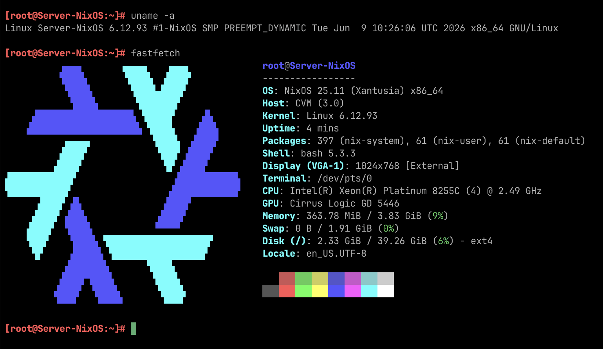
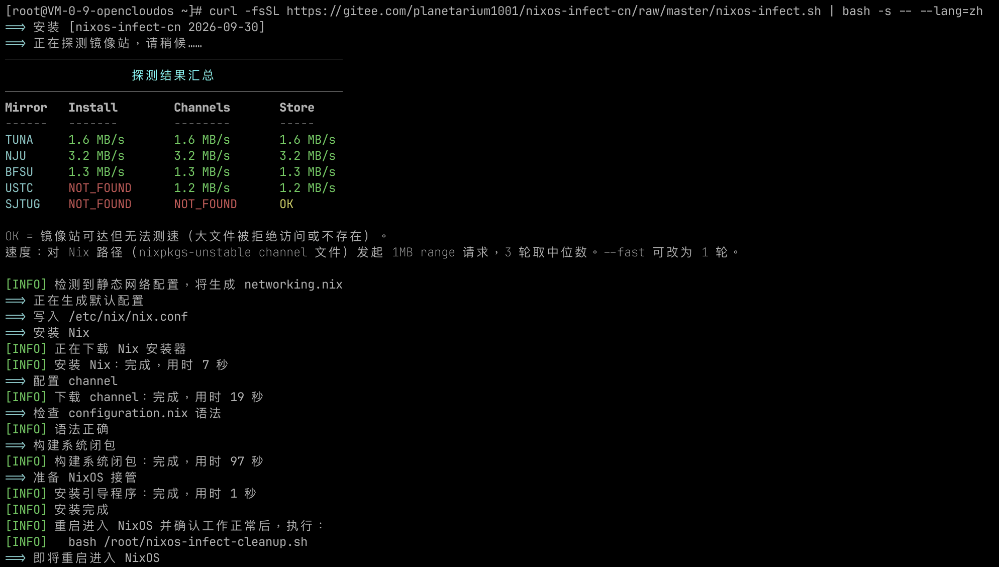
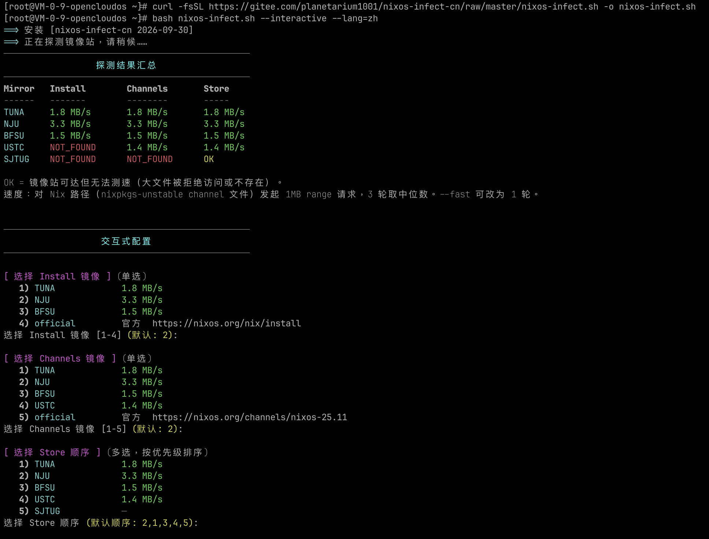
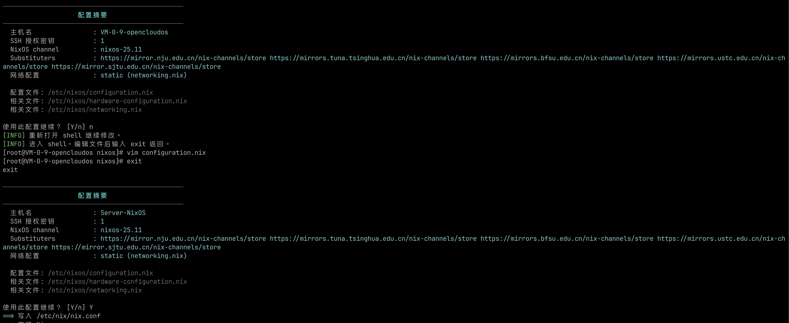
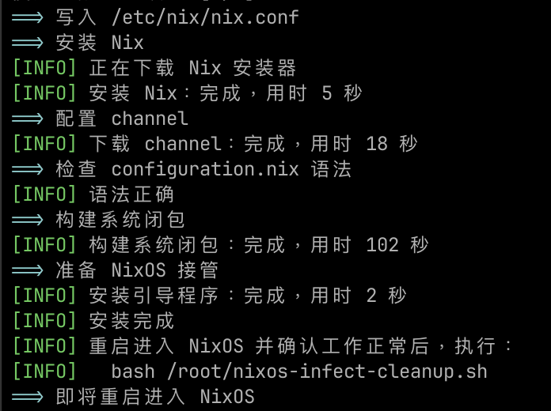
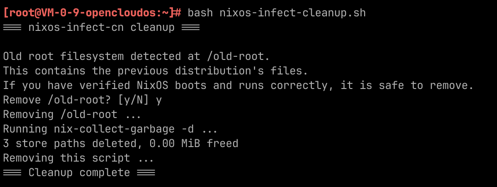

# nixos-infect-cn

Convert a cloud server from Debian / Ubuntu / OpenCloudOS to NixOS using China-accessible mirrors.

[中文](./README.md) | **English**



*After conversion: `uname -a` and fastfetch confirm NixOS 25.11.*

| Item | Value |
| --- | --- |
| Version | `2026-10-01` |
| Tested result | NixOS 25.11 |
| Upstream | [elitak/nixos-infect](https://github.com/elitak/nixos-infect) |
| References | [lzc256/nixos-infect-cn](https://github.com/lzc256/nixos-infect-cn), [kidonng/nixos-infect-tuna](https://gist.github.com/kidonng/852ea559816420acaf33017c6e7ccf8b) |
| License | [GPL-3.0](./LICENSE) |

- **Single file, no build step** — one shell script does everything, no local packaging needed.
- **Mirrors end to end** — installer, channel and binary cache all use domestic mirrors.
- **Automatic probing** — resolves the latest stable NixOS and picks the fastest mirror.
- **Configurable before install** — interactive mode lets you edit `configuration.nix`; flake settings can be added by hand.
- **Keeps what matters** — existing SSH host keys are preserved, so the fingerprint does not change.

## Warning

- **The target disk will be wiped.** Run this only on a fresh machine with no data to keep.
- **SSH public-key login is mandatory.** After conversion, the root account is reachable by key only.
- **Shared-kernel virtualization is unsupported.** OpenVZ / LXC containers will not work.
- **EFI boot is untested.** All verified platforms are KVM + BIOS, see the table below.

## Quick start

```bash
# 1. Install your public key (key-based login is the only way in)
ssh-copy-id root@<server-ip>

# 2. Run the installer (automatic, English output by default)
curl -fsSL https://cdn.jsdelivr.net/gh/planetarium1001/nixos-infect-cn@master/nixos-infect.sh | bash

# 3. Wait for the automatic reboot, then log in with the same key
ssh root@<server-ip>
```

- Piped execution has no terminal, so every prompt takes its default value.
- To review or edit the configuration first, use [interactive mode](./docs/en/installation.md#method-2-interactive-install).
- Step-by-step guidance and expected output: [quick start](./docs/en/quickstart.md).

Full output of the one-command install (probe → install → build → takeover → reboot):



### Download sources

| Source | URL |
| --- | --- |
| jsDelivr (recommended) | `https://cdn.jsdelivr.net/gh/planetarium1001/nixos-infect-cn@master/nixos-infect.sh` |
| Gitee mirror | `https://gitee.com/planetarium1001/nixos-infect-cn/raw/master/nixos-infect.sh` |
| GitHub proxy | `https://gh-proxy.com/https://raw.githubusercontent.com/planetarium1001/nixos-infect-cn/master/nixos-infect.sh` |
| GitHub raw | `https://raw.githubusercontent.com/planetarium1001/nixos-infect-cn/master/nixos-infect.sh` |

- jsDelivr caches branch references; use a commit id in place of `@master` to get the latest revision.
- Gitee sync lags behind GitHub, and may answer `451` for large files.
- The GitHub raw endpoint is unstable from mainland China; avoid it when possible.
- Details and workarounds: [mirrors and probing](./docs/en/mirrors.md).

## Interactive mode preview

Add `--interactive` when you want to change the configuration first: pick mirrors, edit config, then install.

| Choose mirrors | Edit configuration |
| --- | --- |
| [](./screenshots/interactive_0.png) | [](./screenshots/interactive_1.png) |



- Left: probe summary and three mirror choices; right: summary, shell editing, and the re-read summary.
- Click an image to open the original; interactive mode requires downloading the script first.

## Verified platforms

| Platform | Original system | Boot | Result |
| --- | --- | --- | --- |
| Tencent Cloud Lighthouse | OpenCloudOS 8 / 9 | BIOS | Pass |
| Tencent Cloud Lighthouse | Ubuntu 20.04 / 22.04 / 24.04 / 26.04 LTS | BIOS | Pass |
| Tencent Cloud Lighthouse | Debian 10.2 / 11.1 / 12.0 / 13.2 | BIOS | Pass |

- All are KVM + BIOS instances; the converted system is NixOS 25.11.
- DHCP works, SSH login works, and host keys are preserved.
- `nix-channel --update` and `nixos-rebuild` both use domestic mirrors.
- **Unlisted versions are unverified.** Upstream experience: LTS releases are stable, non-LTS (e.g. Ubuntu 22.10 / 23.10) fail.

## Documentation

| Document | Contents |
| --- | --- |
| [Quick start](./docs/en/quickstart.md) | First install in 5 minutes, with expected output |
| [Installation](./docs/en/installation.md) | Four install modes, special cases, post-install checks |
| [Configuration](./docs/en/configuration.md) | Three ways to customize, placeholder reference, examples |
| [CLI reference](./docs/en/cli.md) | Every flag, environment variable, common combinations |
| [Mirrors](./docs/en/mirrors.md) | Mirror matrix, probing algorithm, cache, manual selection |
| [How it works](./docs/en/how-it-works.md) | Seven-stage pipeline, key mechanisms, script map |
| [Cleanup](./docs/en/cleanup.md) | What the cleanup script does, when and how to run it |
| [Troubleshooting](./docs/en/troubleshooting.md) | Symptom table and detailed failure cases |
| [FAQ](./docs/en/faq.md) | Data and rollback, compatibility, network, security |
| [Development](./docs/en/development.md) | Code / comment / docs conventions, testing, release |

- Chinese docs live in [`docs/zh-CN/`](./docs/zh-CN/) and mirror this structure.
- Full index: [`docs/README.md`](./docs/README.md). Original upstream README: [`README.upstream.md`](./README.upstream.md).

## Common flags

| Flag | Description |
| --- | --- |
| `--lang=zh` | Chinese output (default `en`) |
| `--interactive` | Pick mirrors, edit config; requires a terminal |
| `--dry-run` | Probe and generate config only, output to `/tmp/nixos-infect-dryrun` |
| `--no-reboot` | Do not reboot after install, so you can inspect artifacts |
| `--no-probe` | Skip probing and use the fallback mirror order |
| `--prefer=NAME` | Prefer a mirror: `TUNA` `NJU` `BFSU` `USTC` `SJTUG` |

See [CLI reference](./docs/en/cli.md) for the complete list and combinations.

## After installation

```bash
# Verify the converted system
nixos-version                # expect 25.11
nix-channel --list           # should point at a domestic mirror
nix config show | grep substituters

# Once confirmed working, remove the old system (asks for confirmation)
bash /root/nixos-infect-cleanup.sh
```

- Cannot reach SSH after reboot: see [troubleshooting](./docs/en/troubleshooting.md#ssh-unreachable-after-reboot).
- Still booting the old system: see [host boot cache](./docs/en/troubleshooting.md#still-boots-the-old-system).
- Cleanup details: see [cleanup](./docs/en/cleanup.md).



*After confirmation the cleanup script removes `/old-root` and `/boot.bak`, then collects Nix garbage.*

## Repository layout

```text
.
├── nixos-infect.sh        # single-file installer, sections 1-11
├── nixos-infect.en.sh     # English-comment edition (same code as the main script)
├── README.md              # Chinese documentation
├── README.en.md           # English documentation (this file)
├── README.upstream.md     # original upstream README
├── docs/
│   ├── README.md          # documentation index
│   ├── zh-CN/             # Chinese docs
│   └── en/                # English docs
├── .editorconfig          # editor defaults (UTF-8 / LF / 2 spaces)
├── scripts/               # maintenance scripts (not used during install)
│   └── verify-comment-parity.sh
├── screenshots/           # documentation images
└── LICENSE                # GPL-3.0
```

## Contributing

- Read [development](./docs/en/development.md) before changing the script.
- Comments are written in Chinese; user-visible strings go through the i18n tables in `SECTION 2`.
- English readers can use [nixos-infect.en.sh](./nixos-infect.en.sh): identical code, English comments only.
- After changing code, sync both scripts and run `bash scripts/verify-comment-parity.sh`.
- Documentation changes must land in both languages, using short paragraphs and bullet lists.
- Before committing, run `bash -n nixos-infect.sh` and `shellcheck nixos-infect.sh`.
- When you verify a new platform, update the table here and in [installation](./docs/en/installation.md).

## Credits

- [elitak/nixos-infect](https://github.com/elitak/nixos-infect) — upstream project
- [lzc256/nixos-infect-cn](https://github.com/lzc256/nixos-infect-cn) — reference implementation
- [kidonng/nixos-infect-tuna](https://gist.github.com/kidonng/852ea559816420acaf33017c6e7ccf8b) — TUNA patch idea
- TUNA, NJU, BFSU, USTC and SJTUG mirror sites

## License

[GNU General Public License v3.0](./LICENSE), same as upstream.
