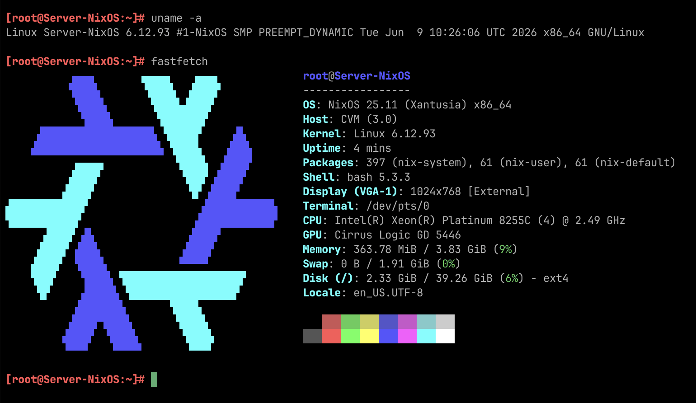
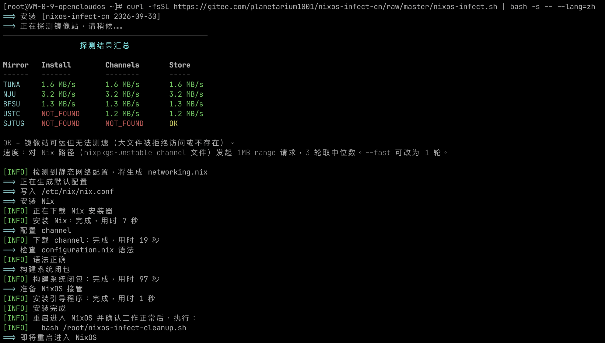
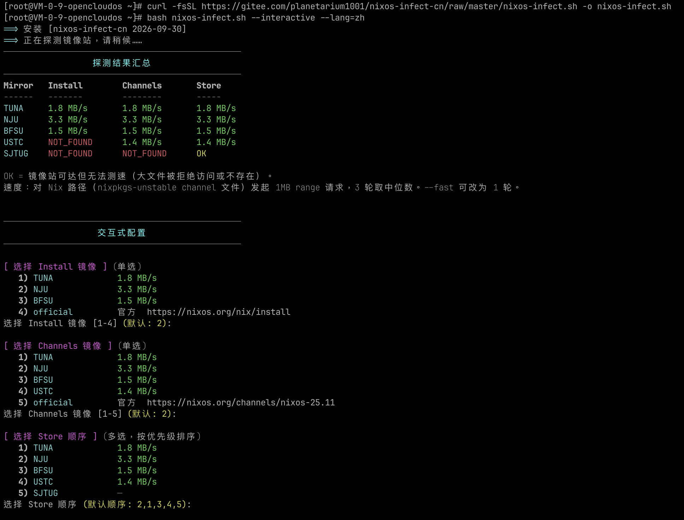
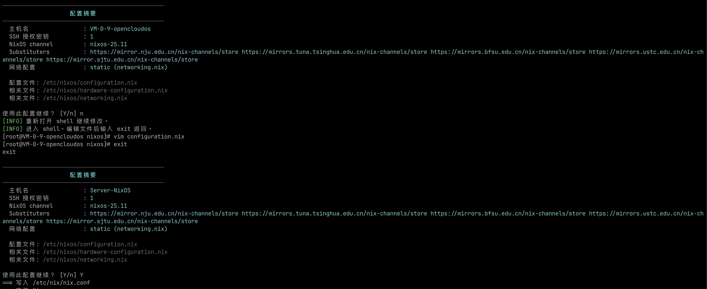
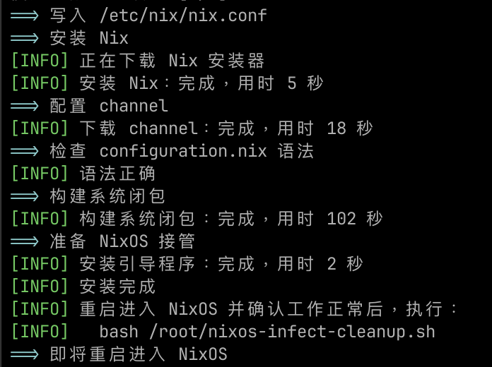
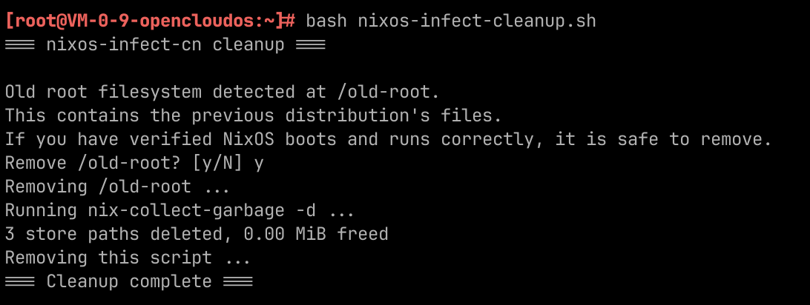

# nixos-infect-cn

使用国内镜像源，将云服务器的 Debian / Ubuntu / OpenCloudOS 覆盖安装为 NixOS。

**中文** | [English](./README.en.md)



*转换完成后：`uname -a` 与 fastfetch 确认系统已是 NixOS 25.11。*

| 项目 | 内容 |
| --- | --- |
| 版本 | `2026-10-01` |
| 实测结果 | NixOS 25.11 |
| 上游 | [elitak/nixos-infect](https://github.com/elitak/nixos-infect) |
| 参考 | [lzc256/nixos-infect-cn](https://github.com/lzc256/nixos-infect-cn)、[kidonng/nixos-infect-tuna](https://gist.github.com/kidonng/852ea559816420acaf33017c6e7ccf8b) |
| 许可 | [GPL-3.0](./LICENSE) |

- **单文件、免构建**：一个 shell 脚本完成全部工作，不需要本地打包环境。
- **全链路国内镜像**：安装器、channel、二进制缓存都走国内镜像站。
- **自动探测**：自动解析最新稳定版 NixOS，并测速挑选最快的镜像。
- **可先改配置**：交互模式可在安装前编辑 `configuration.nix`，可自行加入 flake 配置。
- **保留关键状态**：沿用原 SSH host key，转换后指纹不变。

## 警告

- **会清空服务器磁盘**：请只在新机器上运行，并确认没有需要保留的数据。
- **必须先配置 SSH 公钥登录**：转换后 root 没有密码，公钥是唯一登录方式。
- **不支持共享内核虚拟化**：OpenVZ、LXC 等场景无法安装。
- **EFI 引导尚未实测**：已验证平台均为 KVM + BIOS，见下方表格。

## 快速开始

```bash
# 1. 上传公钥（转换后 root 无密码，这一步不能省）
ssh-copy-id root@<服务器IP>

# 2. 一键安装（中文输出，全自动）
curl -fsSL https://cdn.jsdelivr.net/gh/planetarium1001/nixos-infect-cn@master/nixos-infect.sh | bash -s -- --lang=zh

# 3. 等待自动重启，再用原密钥登录
ssh root@<服务器IP>
```

- 管道执行没有终端，所有提问自动取默认值。
- 想先看配置、改配置，请改用[交互模式](./docs/zh-CN/installation.md#方式二交互式安装)。
- 完整步骤、预期输出与耗时说明见[快速开始文档](./docs/zh-CN/quickstart.md)。

一键安装的完整输出（探测 → 安装 → 构建 → 接管 → 重启）：



### 下载源

| 源 | 地址 |
| --- | --- |
| jsDelivr（推荐） | `https://cdn.jsdelivr.net/gh/planetarium1001/nixos-infect-cn@master/nixos-infect.sh` |
| Gitee 镜像 | `https://gitee.com/planetarium1001/nixos-infect-cn/raw/master/nixos-infect.sh` |
| GitHub 加速 | `https://gh-proxy.com/https://raw.githubusercontent.com/planetarium1001/nixos-infect-cn/master/nixos-infect.sh` |
| GitHub 原始 | `https://raw.githubusercontent.com/planetarium1001/nixos-infect-cn/master/nixos-infect.sh` |

- jsDelivr 会缓存分支引用；要立即取到最新版，请把 `@master` 换成具体 commit id。
- Gitee 同步有延迟；对内容较多的文件可能返回 `451`。
- GitHub 原始地址在国内不稳定，不建议直接使用。
- 各下载源的差异与处理方式见[镜像与探测](./docs/zh-CN/mirrors.md)。

## 交互模式预览

需要先改配置时加 `--interactive`，流程分三步：选择镜像、编辑配置、开始安装。

| 选择镜像 | 编辑配置 |
| --- | --- |
| [](./screenshots/interactive_0.png) | [](./screenshots/interactive_1.png) |



- 左图：探测汇总与三次镜像选择；右图：配置摘要、进入 shell 编辑、回读摘要。
- 点击图片查看原图；交互模式需要先下载脚本，管道执行没有终端。

## 已验证平台

| 平台 | 原始系统 | 引导 | 结果 |
| --- | --- | --- | --- |
| 腾讯云 Lighthouse | OpenCloudOS 8 / 9 | BIOS | 通过 |
| 腾讯云 Lighthouse | Ubuntu 20.04 / 22.04 / 24.04 / 26.04 LTS | BIOS | 通过 |
| 腾讯云 Lighthouse | Debian 10.2 / 11.1 / 12.0 / 13.2 | BIOS | 通过 |

- 均为 KVM + BIOS 实例，转换结果为 NixOS 25.11。
- DHCP 正常、SSH 可登录、host key 保留。
- 安装后 `nix-channel --update` 与 `nixos-rebuild` 均走国内镜像。
- **未列出的系统版本未经验证**；上游经验是 LTS 稳定、非 LTS（如 Ubuntu 22.10 / 23.10）失败。

## 文档

| 文档 | 内容 |
| --- | --- |
| [快速开始](./docs/zh-CN/quickstart.md) | 5 分钟完成首次安装，含每一步的预期结果 |
| [安装教程](./docs/zh-CN/installation.md) | 四种安装方式、特殊场景、安装后验证清单 |
| [配置定制](./docs/zh-CN/configuration.md) | 三种改配置方式、占位符全表、常见示例 |
| [参数与环境变量](./docs/zh-CN/cli.md) | 全部参数、环境变量、常用组合、日志与中止行为 |
| [镜像与探测](./docs/zh-CN/mirrors.md) | 镜像能力矩阵、探测算法、缓存与手动指定 |
| [工作原理](./docs/zh-CN/how-it-works.md) | 七阶段流程、关键机制、脚本分区索引 |
| [安装后清理](./docs/zh-CN/cleanup.md) | 清理脚本做了什么、何时清理、手动清理 |
| [排障指南](./docs/zh-CN/troubleshooting.md) | 症状速查表与典型故障案例 |
| [常见问题](./docs/zh-CN/faq.md) | 数据回滚、兼容性、网络、安全 |
| [项目规范与贡献](./docs/zh-CN/development.md) | 代码 / 注释 / 文档规范、测试与发布流程 |

- 英文文档位于 [`docs/en/`](./docs/en/)，与中文目录一一对应。
- 文档索引见 [`docs/README.md`](./docs/README.md)；上游原始 README 见 [`README.upstream.md`](./README.upstream.md)。

## 常用参数

| 参数 | 说明 |
| --- | --- |
| `--lang=zh` | 中文输出（默认 `en`） |
| `--interactive` | 交互模式：选镜像、编辑配置，需要终端 |
| `--dry-run` | 只探测并生成配置，不安装，输出到 `/tmp/nixos-infect-dryrun` |
| `--no-reboot` | 安装后不重启，便于先检查产物 |
| `--no-probe` | 跳过探测，直接使用保底镜像顺序 |
| `--prefer=NAME` | 优先镜像：`TUNA` `NJU` `BFSU` `USTC` `SJTUG` |

完整参数、环境变量与组合示例见[参数与环境变量](./docs/zh-CN/cli.md)。

## 安装之后

```bash
# 验证系统状态
nixos-version                # 预期 25.11
nix-channel --list           # 应指向国内镜像
nix config show | grep substituters

# 确认系统正常后，清理旧系统残留（交互确认）
bash /root/nixos-infect-cleanup.sh
```

- 重启后无法 SSH：先看[排障指南](./docs/zh-CN/troubleshooting.md#重启后-ssh-连不上)。
- 重启后仍是原系统：见[宿主机引导缓存](./docs/zh-CN/troubleshooting.md#重启后仍是原系统)。
- 清理脚本行为与手动清理：见[安装后清理](./docs/zh-CN/cleanup.md)。



*清理脚本确认后删除 `/old-root` 与 `/boot.bak`，并回收 Nix store。*

## 项目结构

```text
.
├── nixos-infect.sh        # 单文件安装脚本，按 SECTION 1-11 分区
├── nixos-infect.en.sh     # 英文注释版（代码与主脚本完全一致）
├── README.md              # 中文说明（本文件）
├── README.en.md           # 英文说明
├── README.upstream.md     # 上游原始 README
├── docs/
│   ├── README.md          # 文档索引
│   ├── zh-CN/             # 中文文档
│   └── en/                # 英文文档
├── .editorconfig          # 编辑器统一格式（UTF-8 / LF / 2 空格）
├── scripts/               # 维护脚本（不参与安装）
│   └── verify-comment-parity.sh
├── screenshots/           # 文档配图
└── LICENSE                # GPL-3.0
```

## 贡献与维护

- 修改脚本前请先读[项目规范与贡献](./docs/zh-CN/development.md)。
- 注释用中文；用户可见文案必须走脚本 `SECTION 2` 的 i18n 表。
- 英文读者使用 [nixos-infect.en.sh](./nixos-infect.en.sh)：代码与主脚本完全一致，仅注释为英文。
- 修改代码后同步两份脚本，并运行 `bash scripts/verify-comment-parity.sh` 校验。
- 文档改动需中英文同步，并保持「短段落 + 列表」的排版风格。
- 提交前至少执行：`bash -n nixos-infect.sh`、`shellcheck nixos-infect.sh`。
- 新增已验证平台时，请同时更新本页表格与[安装教程](./docs/zh-CN/installation.md)。

## 致谢

- [elitak/nixos-infect](https://github.com/elitak/nixos-infect) —— 上游项目
- [lzc256/nixos-infect-cn](https://github.com/lzc256/nixos-infect-cn) —— 参考实现
- [kidonng/nixos-infect-tuna](https://gist.github.com/kidonng/852ea559816420acaf33017c6e7ccf8b) —— TUNA 补丁思路
- TUNA、NJU、BFSU、USTC、SJTUG 镜像站

## License

[GNU General Public License v3.0](./LICENSE)，与上游保持一致。
