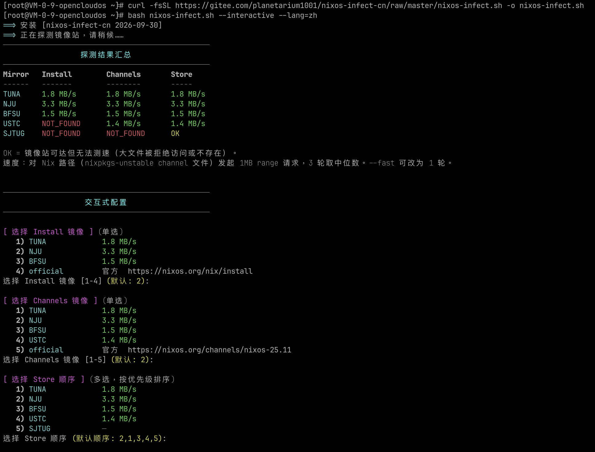
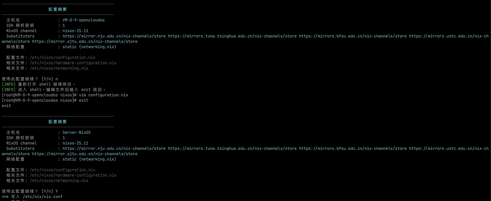
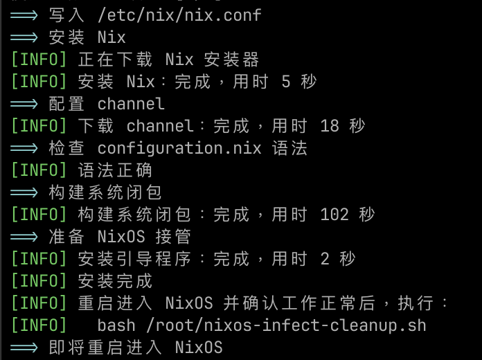

# Installation

[中文](../zh-CN/installation.md) | English

This page details the four execution modes, special cases such as static IP / EFI / an existing configuration, and what each stage of the install does.
On your first run, read the [quick start](./quickstart.md) first, then come back here to pick the mode that suits you.

## Choose an install method

| Method | When to use | Command | Needs a terminal |
| --- | --- | --- | --- |
| One-command pipe | Fresh machine, defaults are fine | `curl ... \| bash -s -- --lang=zh` | No |
| Interactive | You want to pick mirrors and edit the config | `bash nixos-infect.sh --interactive --lang=zh` | Yes |
| dry-run rehearsal | You only want to see the generated config | `bash nixos-infect.sh --dry-run --lang=zh` | No |
| Two-step run | First time, want to check the artifacts before rebooting | `bash nixos-infect.sh --no-reboot --lang=zh` | No |

- The `curl ...` in the table stands for the full download command in the [quick start](./quickstart.md).
- Every mode must run as root; the script wipes the disk, so use it only on a fresh machine.

## Method 1: one-command install

```bash
curl -fsSL https://cdn.jsdelivr.net/gh/planetarium1001/nixos-infect-cn@master/nixos-infect.sh | bash -s -- --lang=zh
```

- `-s --`: makes `bash` treat what follows as script arguments rather than bash's own options.
- `--lang=zh`: Chinese output, default `en`.
- Any flags may follow `--`, for example `--fast`, `--prefer=TUNA`, `--no-reboot`.

Non-interactive behaviour:

- There is no TTY, so the script does not read stdin and every prompt takes its default value.
- When `/etc/nixos/configuration.nix` already exists it is used as is and never overwritten.
- On a configuration syntax error or a failed build there is no shell to edit in: the script aborts and asks you to fix the file and re-run.

## Method 2: interactive install

You must download the script to the server before running it; piped mode has no terminal and cannot be interactive.

```bash
curl -fsSL https://cdn.jsdelivr.net/gh/planetarium1001/nixos-infect-cn@master/nixos-infect.sh -o nixos-infect.sh
bash nixos-infect.sh --interactive --lang=zh
```

The flow is:

- Probe the mirrors and print the summary table, then choose the installer, channel and binary cache separately.
- Show the configuration summary; answer `n` to open a shell under `/etc/nixos` and edit the config, `exit` to return.
- The summary re-reads the file contents, and installation starts once you confirm.







- Installer and channel are single-choice, the binary cache is multi-choice, and the input order sets the priority.
- In every menu you can press Enter to take the default; `--yes` skips the final confirmation prompt.
- Editing `hardware-configuration.nix` directly affects the boot loader, so do not change it if you are unsure of the consequences.

## Method 3: rehearse before installing

### dry-run: generate the config only

```bash
bash nixos-infect.sh --dry-run --lang=zh
```

- It only probes the mirrors and generates the config; it does not install, does not reboot and does not write to `/etc/nixos`.
- When `CONFIG_DIR` is not set explicitly, the artifacts go to `/tmp/nixos-infect-dryrun`.

Check the artifacts:

```bash
ls -l /tmp/nixos-infect-dryrun
cat /tmp/nixos-infect-dryrun/configuration.nix
cat /tmp/nixos-infect-dryrun/hardware-configuration.nix
```

### --no-reboot: install without rebooting

Step one, finish the install but stop before the reboot:

```bash
bash nixos-infect.sh --no-reboot --lang=zh
cat /etc/NIXOS_LUSTRATE
cat /etc/nixos/configuration.nix
ls -l /nix/var/nix/profiles/system
```

Step two, reboot manually once everything checks out:

```bash
reboot
```

- `/etc/NIXOS_LUSTRATE` already lists the paths to preserve across the reboot; after the reboot NixOS takes over and moves the previous system to `/old-root`.

## Special cases

### Static IP (--networking)

The script generates `networking.nix` automatically only when all of the following hold:

- A default route exists, and the interface has an IPv4 address.
- No DHCP traces are found (no lease in `/var/lib/dhcp`, `/var/lib/dhcpcd` or `/run/systemd/netif/leases`).
- The interface address is not marked `dynamic`.

- `--networking` forces generation; `--no-networking` forces it off.
- If generation is forced but no network interface or IPv4 address can be read, the script fails outright instead of writing an empty config that would leave you locked out after the reboot.
- The generated `networking.nix` disables `dhcpcd`, and takes the nameservers from `/etc/resolv.conf`.

### EFI boot (untested)

EFI is untested; the script decides the boot mode by whether `/sys/firmware/efi` exists.

- It looks for the ESP mount point in `/boot/EFI`, `/boot/efi` and `/boot`, in that order, and references it through `/dev/disk/by-uuid/...`.
- `hardware-configuration.nix` uses `efiSupport = true;` and `efiInstallAsRemovable = true;`.
- During installation the old `/boot` is backed up to `/boot.bak`, and the cleanup script deletes it.

On EFI machines, add `--no-reboot` first and check the generated ESP path before rebooting.

### Existing usable configuration

When `/etc/nixos/configuration.nix` already exists, the script does not overwrite it silently.

- Interactive mode offers three options: `1` use it and continue installing; `2` open a shell to review and modify it; `3` overwrite it with the default configuration.
- Non-interactive mode keeps the existing configuration as is, which suits cases where you prepared the config by hand in advance.

### Skipping swap

- `--no-swap` or the environment variable `NO_SWAP=1` skips creating the temporary swap file and also skips unmounting it at the end.
- When the previous system already has a real swap partition, the script writes the devices into `swapDevices` in `hardware-configuration.nix` and disables the temporary swap automatically.
- With no swap in place and nothing disabled, the generated config enables `zramSwap.enable = true;`.

### Skipping probing

- `--no-probe`: no speed test at all; use the fallback order TUNA → NJU → BFSU → USTC → SJTUG directly, with the channel pinned to `nixos-25.11`.
- `--skip-probe`: reuse the cache in `/tmp/nixos-infect-cn.probe` if it is less than 1 hour old; when the cache is missing or stale it asks whether to probe again (default: probe again).
- `--prefer=TUNA`: name a preferred mirror; combined with `--skip-probe` it also ignores the cache and probes again.
- `--fast`: probe each mirror for only 1 round instead of the default 3 rounds with the median taken.

## What happens during installation

- **Probing** — installer, channel and binary cache are probed independently in three dimensions and sorted by measured speed.
  - Results are cached in `/tmp/nixos-infect-cn.probe` for 1 hour.
  - With `--no-probe` this step is skipped and the fallback order is used directly.
- **Generate configuration** — written to `/etc/nixos`, inheriting the hostname and domain of the previous system by default.
  - `hardware-configuration.nix` is generated as well; `networking.nix` is added when a static network is detected.
  - Public keys are collected from the previous system's `authorized_keys` and written into root's `authorizedKeys`.
- **Syntax check** — `nix-instantiate --parse` validates `configuration.nix`.
  - On failure you get a shell to fix it and retry; without a terminal the script aborts.
- **Build the closure** — builds the system profile into `/nix/var/nix/profiles/system`, downloading through the selected binary cache.
  - Full output goes to `/var/log/nixos-infect.log`; the screen keeps only the stage messages.
- **Prepare the takeover** — `touch /etc/NIXOS`, and append the paths to preserve to `/etc/NIXOS_LUSTRATE`.
  - After the reboot the previous system moves to `/old-root` as a whole, and the SSH host key is preserved together with `/etc/nixos`.
- **Install the boot loader** — runs `switch-to-configuration boot` to write GRUB / ESP.
  - It then `touch`es `/boot/vmlinuz-*` and `/boot/initrd.img-*` to invalidate the boot entries cached by the host machine, and runs `sync` to flush to disk.
- **Reboot** — reboots into NixOS automatically; with `--no-reboot` it stops here and you run `reboot` yourself.

## Post-install checklist

- You can log in with the original key, and the host key has not changed.
- `nixos-version` prints `25.11 (Xantusia)`.
- `nixos` in `nix-channel --list` points at a domestic mirror.
- `nix config show | grep substituters` shows the mirror URLs.
- Services from the previous system (nginx, databases and the like) are not migrated automatically; declare them in NixOS and run `nixos-rebuild switch`.
- The cloud vendor's monitoring agent no longer runs, so console metrics may be missing.
- Once everything works, run [post-install cleanup](./cleanup.md).

## Related documentation

- [Quick start](./quickstart.md)
- [Configuration](./configuration.md)
- [CLI reference](./cli.md)
- [Troubleshooting guide](./troubleshooting.md)
