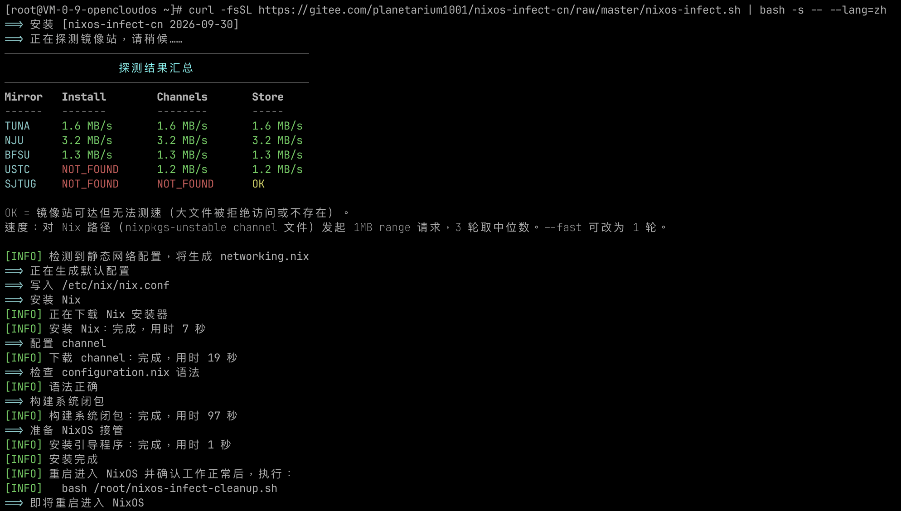
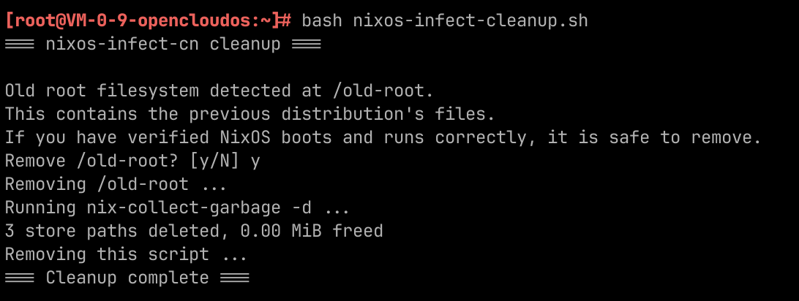

# Quick start (5 minutes)

[中文](../zh-CN/quickstart.md) | English

This page is for a fresh cloud server you are ready to reinstall, and takes the shortest path to replace its system with NixOS.
Three steps in total: upload the public key, run the one-command install, then log in again with the same key after the reboot.

> **Warning**: the script takes over the system disk and moves the previous system to `/old-root`; treat all data on the machine as unrecoverable. After conversion root has no password, so the public key is the only way in.

## Before you start

- **The machine can be wiped**: make sure there is no data, snapshot or mounted disk you need to keep.
- **An SSH public key is set up**: you already have a key locally and can log in to the target instance as root without a password.
- **You have root access**: the script must run as root, and `curl ... | bash` runs as root by default.
- **Full virtualization**: KVM, VMware and the like are fine; shared-kernel instances such as OpenVZ and LXC are not supported.
- **Note the console entry point**: check where VNC / remote connection lives in your provider's console beforehand; it is your way back in if the reboot goes silent.
- **The network is open**: the security group allows port 22, and you have noted the instance's public IP.

## Three steps

### Step 1: upload the SSH public key

After conversion the root account has no password, so a missing public key means you can never log in again.

```bash
ssh-copy-id root@<server-ip>
ssh root@<server-ip> true && echo OK
```

The second command should print `OK`; if it prints nothing, fix key-based login first and do not continue.

### Step 2: one-command install

Run this as root on the target server, picking either download source.

jsDelivr (recommended):

```bash
curl -fsSL https://cdn.jsdelivr.net/gh/planetarium1001/nixos-infect-cn@master/nixos-infect.sh | bash -s -- --lang=zh
```

Gitee mirror:

```bash
curl -fsSL https://gitee.com/planetarium1001/nixos-infect-cn/raw/master/nixos-infect.sh | bash -s -- --lang=zh
```

- jsDelivr caches branch references; to get the latest revision right away, replace `@master` with a specific commit id.
- Gitee syncs from GitHub, so pushes arrive with a delay; while content is under review, `raw` may return `451`.
- Piped execution has no terminal, so every prompt takes its default value; download the script and run it if you want interaction.

### Step 3: wait for the automatic reboot and log in again

- When the install finishes the script runs `reboot` automatically; the SSH session dropping is expected.
- Wait for the instance to finish rebooting, then log in with the same key; the host key is inherited from the previous system, so the fingerprint does not change.

```bash
ssh root@<server-ip>
nixos-version
```

If you still cannot connect, open the console VNC for a look first; see "When something goes wrong" below.

## What you should see

The screen output advances in this order, with green `[INFO]` for status and cyan `==>` for steps.



- **Probe summary table**: lists installer / channel / cache speeds for TUNA, NJU, BFSU, USTC and SJTUG.
- **Generate configuration**: writes to `/etc/nixos`; in interactive mode the configuration summary follows so you can confirm or change it.
- **Install Nix and the channel**: downloads the installer, runs `nix-channel --update`, then checks the configuration syntax.
- **Build the system closure**: the slowest step; the screen may show no new lines for several minutes, which is normal.
- **Install the boot loader**: writes GRUB / ESP, then reboots into NixOS automatically.

Duration depends on bandwidth and instance performance, usually **10-30 minutes**; the probing stage itself is fast.
Add `--verbose` to see detailed output for every step; the full log is at `/var/log/nixos-infect.log`.

## Verify after installation

```bash
nixos-version
nix-channel --list
nix config show | grep substituters
systemctl status sshd
```

- `nixos-version`: prints `25.11 (Xantusia)`.
- `nix-channel --list`: `nixos` points at a domestic mirror rather than `channels.nixos.org`.
- `nix config show | grep substituters`: shows `substituters = ...` with values such as TUNA and other domestic mirrors.
- `systemctl status sshd`: `active (running)`; being able to log in over SSH already proves it works.

## Clean up the previous system

Once you have confirmed that NixOS boots normally and its services work, run the cleanup script to reclaim the space the previous system occupies.

```bash
bash /root/nixos-infect-cleanup.sh
```



- It first checks `/run/current-system` and `ID=nixos` in `/etc/os-release`, and refuses to run when it is not on NixOS.
- It asks whether to delete `/old-root`, and deletes it only after you type `y` / `yes`.
- It then deletes `/boot.bak` and runs `nix-collect-garbage -d`; it removes itself only once `/old-root` has been deleted.

Details: [post-install cleanup](./cleanup.md).

## When something goes wrong

- **SSH never connects after the reboot**: check the console VNC first; the usual cause is a hang during shutdown, and one manual reboot is enough.
- **The reboot still lands in the previous system**: if `cat /etc/NIXOS_LUSTRATE` still exists, NixOS never booted, so follow the [troubleshooting guide](./troubleshooting.md).
- **Probing or downloading is too slow**: switch to `--fast`, or name a mirror with `--prefer=TUNA`; see the [CLI reference](./cli.md).
- **Configuration syntax error**: piped mode cannot open a shell for editing, so the script aborts; download the script and re-run it with `--interactive`.
- **Console metrics disappear**: the vendor's monitoring agent no longer runs on NixOS, which is expected behaviour.

## Related documentation

- [Installation](./installation.md)
- [Configuration](./configuration.md)
- [Troubleshooting guide](./troubleshooting.md)
- [CLI reference](./cli.md)
