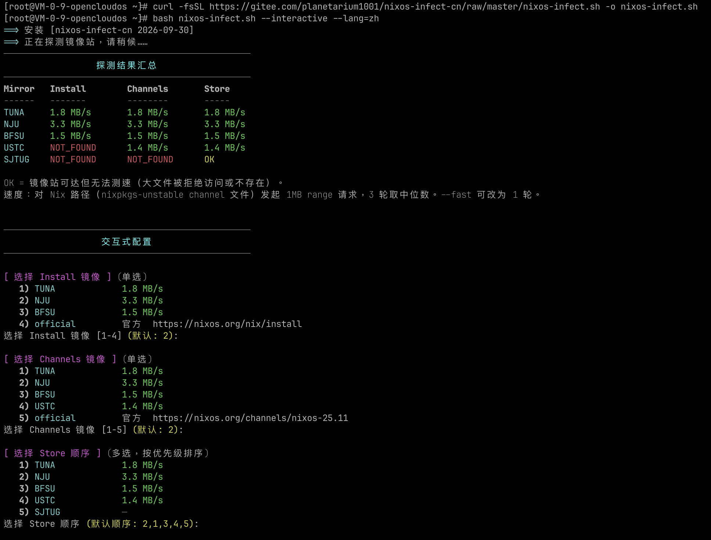
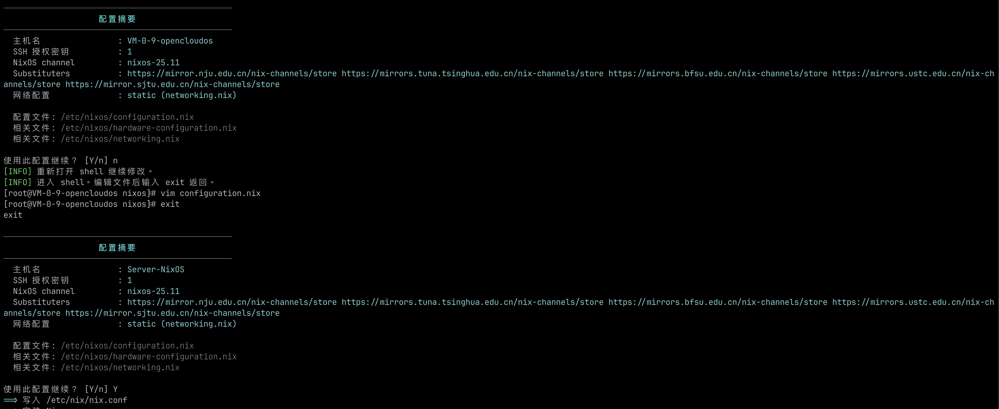
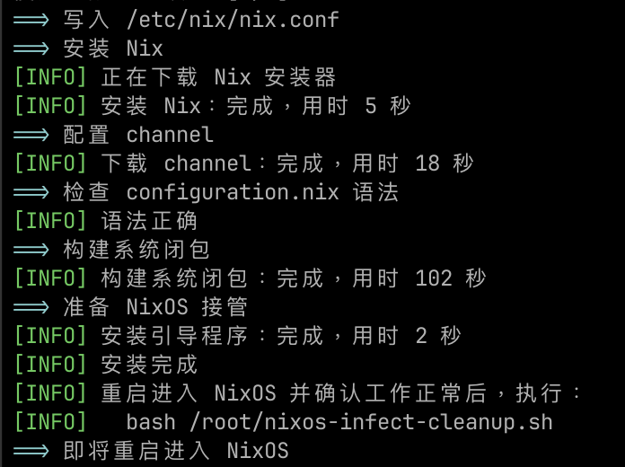

# 安装教程

本文详细说明四种执行方式、静态 IP / EFI / 已有配置等特殊场景，以及安装过程中每个阶段做了什么。
第一次使用建议先看 [快速开始](./quickstart.md)，再回到这里挑合适的方式。

## 选择安装方式

| 方式 | 适用场景 | 命令 | 需要终端 |
| --- | --- | --- | --- |
| 一键管道 | 全新机器，接受默认配置 | `curl ... \| bash -s -- --lang=zh` | 否 |
| 交互式 | 想挑镜像、编辑配置 | `bash nixos-infect.sh --interactive --lang=zh` | 是 |
| dry-run 演练 | 只想看会生成什么配置 | `bash nixos-infect.sh --dry-run --lang=zh` | 否 |
| 两步执行 | 首次使用，想先检查产物再重启 | `bash nixos-infect.sh --no-reboot --lang=zh` | 否 |

- 表中的 `curl ...` 指 [快速开始](./quickstart.md) 里的完整下载命令。
- 所有方式都必须以 root 运行；脚本会清空磁盘，只在新机器上使用。

## 方式一：一键安装

```bash
curl -fsSL https://cdn.jsdelivr.net/gh/planetarium1001/nixos-infect-cn@master/nixos-infect.sh | bash -s -- --lang=zh
```

- `-s --`：让 `bash` 把后面的内容当作脚本参数，而不是 bash 自身的选项。
- `--lang=zh`：中文输出，默认 `en`。
- `--` 之后可追加任意参数，例如 `--fast`、`--prefer=TUNA`、`--no-reboot`。

非交互行为：

- 没有 TTY，脚本不读 stdin，所有提问自动取默认值。
- `/etc/nixos/configuration.nix` 已存在时直接沿用，不会覆盖。
- 配置语法错误或构建失败时无法打开编辑 shell，脚本中止并提示修复后重跑。

## 方式二：交互式安装

必须先把脚本下载到服务器再运行；管道模式拿不到终端，无法交互。

```bash
curl -fsSL https://cdn.jsdelivr.net/gh/planetarium1001/nixos-infect-cn@master/nixos-infect.sh -o nixos-infect.sh
bash nixos-infect.sh --interactive --lang=zh
```

流程如下：

- 探测镜像并打印汇总表，再按安装器、channel、二进制缓存分别选择。
- 显示配置摘要；回答 `n` 进入 `/etc/nixos` 下的 shell 编辑配置，`exit` 返回。
- 摘要重新读取文件内容，确认后开始安装。







- 安装器与 channel 为单选，二进制缓存为多选，按输入顺序决定优先级。
- 每轮菜单都可直接回车取默认项；`--yes` 可跳过最后的确认提示。
- 编辑 `hardware-configuration.nix` 会直接影响引导，不清楚后果时不要改。

## 方式三：先演练再安装

### dry-run：只看配置

```bash
bash nixos-infect.sh --dry-run --lang=zh
```

- 只探测镜像并生成配置，不安装、不重启，也不写 `/etc/nixos`。
- 未显式设置 `CONFIG_DIR` 时，产物写到 `/tmp/nixos-infect-dryrun`。

检查产物：

```bash
ls -l /tmp/nixos-infect-dryrun
cat /tmp/nixos-infect-dryrun/configuration.nix
cat /tmp/nixos-infect-dryrun/hardware-configuration.nix
```

### --no-reboot：装完先不重启

第一步，完成安装但停在重启前：

```bash
bash nixos-infect.sh --no-reboot --lang=zh
cat /etc/NIXOS_LUSTRATE
cat /etc/nixos/configuration.nix
ls -l /nix/var/nix/profiles/system
```

第二步，确认无误后手动重启：

```bash
reboot
```

- `/etc/NIXOS_LUSTRATE` 已列出要跨重启保留的路径，重启后由 NixOS 接管并把原系统搬到 `/old-root`。

## 特殊场景

### 静态 IP（--networking）

脚本仅在以下条件同时成立时自动生成 `networking.nix`：

- 存在默认路由，且接口上有 IPv4 地址。
- 找不到 DHCP 痕迹（`/var/lib/dhcp`、`/var/lib/dhcpcd`、`/run/systemd/netif/leases` 均无租约）。
- 接口地址没有被标记为 `dynamic`。

- `--networking` 强制生成；`--no-networking` 强制不生成。
- 强制生成但读不到网卡或 IPv4 地址时脚本直接失败，不会写出空配置导致重启失联。
- 生成的 `networking.nix` 会关闭 `dhcpcd`，nameservers 取自 `/etc/resolv.conf`。

### EFI 引导（未实测）

EFI 尚未实测；脚本按 `/sys/firmware/efi` 是否存在判断引导模式。

- 依次在 `/boot/EFI`、`/boot/efi`、`/boot` 查找 ESP 挂载点，并用 `/dev/disk/by-uuid/...` 引用。
- `hardware-configuration.nix` 使用 `efiSupport = true;` 与 `efiInstallAsRemovable = true;`。
- 安装时旧 `/boot` 会备份为 `/boot.bak`，清理脚本会删除它。

建议 EFI 机器先加 `--no-reboot`，检查生成的 ESP 路径后再重启。

### 已有可用配置

`/etc/nixos/configuration.nix` 已存在时，脚本不会静默覆盖。

- 交互模式给出三个选项：`1` 直接使用并继续安装；`2` 进 shell 审查修改；`3` 用默认配置覆盖。
- 非交互模式直接沿用已有配置，适合事先手工准备好配置的场景。

### 不想用 swap

- `--no-swap` 或环境变量 `NO_SWAP=1` 跳过创建临时 swap 文件，也跳过结束时的卸载。
- 原系统已有真实 swap 分区时，脚本把设备写进 `hardware-configuration.nix` 的 `swapDevices`，并自动禁用临时 swap。
- 没有现成 swap 且未禁用时，生成配置启用 `zramSwap.enable = true;`。

### 不探测镜像

- `--no-probe`：完全不测速，直接使用保底顺序 TUNA → NJU → BFSU → USTC → SJTUG，channel 固定 `nixos-25.11`。
- `--skip-probe`：复用 `/tmp/nixos-infect-cn.probe` 中 1 小时内的缓存；缓存缺失或过期时会询问是否重新测速（默认重测）。
- `--prefer=TUNA`：指定优先镜像；与 `--skip-probe` 同用时也会忽略缓存重新测速。
- `--fast`：每个镜像只测 1 轮，默认是 3 轮取中位数。

## 安装过程发生了什么

- **探测** — 安装器、channel、二进制缓存三个维度独立探测并按实测速度排序。
  - 结果缓存在 `/tmp/nixos-infect-cn.probe`，有效期 1 小时。
  - `--no-probe` 时跳过这一步，直接使用保底顺序。
- **生成配置** — 写入 `/etc/nixos`，默认继承原系统主机名与域名。
  - 同时生成 `hardware-configuration.nix`；识别到静态网络时再加 `networking.nix`。
  - 公钥从原系统 `authorized_keys` 收集，写进 root 的 `authorizedKeys`。
- **语法检查** — 用 `nix-instantiate --parse` 校验 `configuration.nix`。
  - 失败时进入 shell 修改后重试；没有终端则中止。
- **构建闭包** — 构建系统 profile 到 `/nix/var/nix/profiles/system`，下载走选中的二进制缓存。
  - 完整输出写入 `/var/log/nixos-infect.log`，屏幕只保留阶段提示。
- **准备接管** — `touch /etc/NIXOS`，并向 `/etc/NIXOS_LUSTRATE` 追加要保留的路径。
  - 重启后原系统整体搬到 `/old-root`，SSH host key 与 `/etc/nixos` 一起保留。
- **安装引导** — 执行 `switch-to-configuration boot` 写 GRUB / ESP。
  - 再 `touch` `/boot/vmlinuz-*` 与 `/boot/initrd.img-*` 使宿主机缓存的引导项失效，然后 `sync` 落盘。
- **重启** — 自动重启进入 NixOS；`--no-reboot` 时停在这一步，由你手动执行 `reboot`。

## 安装后验证清单

- 能用原密钥登录，host key 没有变化。
- `nixos-version` 输出 `25.11 (Xantusia)`。
- `nix-channel --list` 中的 `nixos` 指向国内镜像。
- `nix config show | grep substituters` 能看到镜像地址。
- 原系统上的服务（如 nginx、数据库）不会自动迁移，需在 NixOS 中重新声明后 `nixos-rebuild switch`。
- 云厂商监控 agent 不再运行，控制台指标可能缺失。
- 一切正常后执行 [安装后清理](./cleanup.md)。

## 相关文档

- [快速开始](./quickstart.md)
- [配置定制](./configuration.md)
- [参数与环境变量参考](./cli.md)
- [排障指南](./troubleshooting.md)
