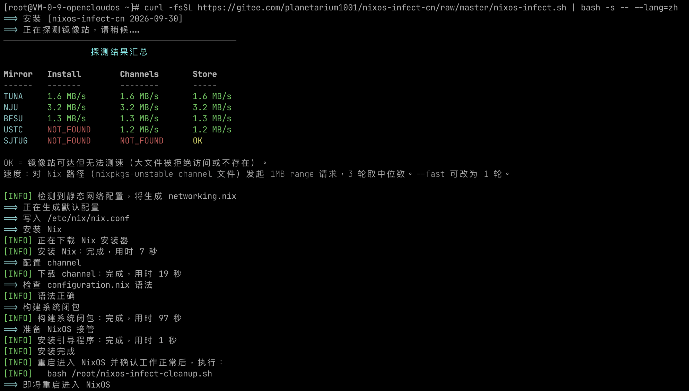
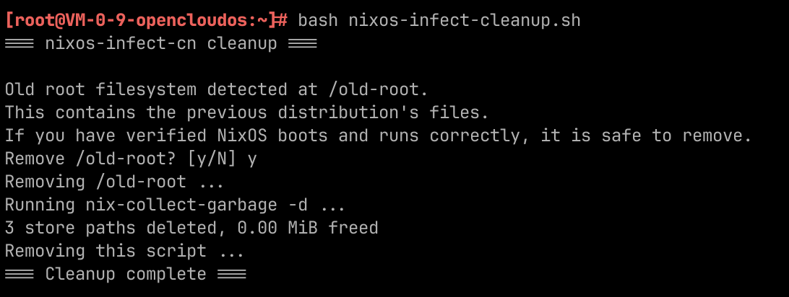

# 快速开始（5 分钟）

本文面向一台准备重装的新云服务器，用最短路径把原系统换成 NixOS。
全程三步：上传公钥、执行一键命令、重启后用同一把密钥重新登录。

> **警告**：脚本会接管系统盘，原系统被移入 `/old-root`，请视为整机数据不可保留；转换后 root 没有密码，公钥是唯一登录方式。

## 开始之前

- **机器可清空**：确认没有需要保留的数据、快照和挂载盘。
- **已配置 SSH 公钥**：本机已有密钥，且能免密登录目标实例的 root。
- **拥有 root 权限**：脚本必须以 root 运行，`curl ... | bash` 默认即为 root。
- **完整虚拟化**：KVM、VMware 等可以；OpenVZ、LXC 等共享内核实例不支持。
- **记下控制台入口**：提前确认云厂商控制台的 VNC / 远程连接位置，重启失联时靠它。
- **网络已放行**：安全组放行 22 端口，并记下实例公网 IP。

## 三步完成

### 步骤 1：上传 SSH 公钥

转换后 root 账户没有密码，缺少公钥会导致永久无法登录。

```bash
ssh-copy-id root@<服务器IP>
ssh root@<服务器IP> true && echo OK
```

第二条命令应输出 `OK`；没有输出就先解决密钥登录，不要继续。

### 步骤 2：一键安装

在目标服务器上以 root 执行，任选一个下载源。

jsDelivr（推荐）：

```bash
curl -fsSL https://cdn.jsdelivr.net/gh/planetarium1001/nixos-infect-cn@master/nixos-infect.sh | bash -s -- --lang=zh
```

Gitee 镜像：

```bash
curl -fsSL https://gitee.com/planetarium1001/nixos-infect-cn/raw/master/nixos-infect.sh | bash -s -- --lang=zh
```

- jsDelivr 会缓存分支引用；需要立刻取到最新版，把 `@master` 换成具体 commit id。
- Gitee 同步自 GitHub，推送后有延迟；内容审核时 `raw` 可能返回 `451`。
- 管道执行没有终端，所有提问自动取默认值；要交互请下载脚本后运行。

### 步骤 3：等待自动重启并重新登录

- 安装完成后脚本自动 `reboot`，SSH 断开是正常现象。
- 等待实例重启完成，再用同一把密钥登录；host key 沿用原系统，不会出现指纹变化。

```bash
ssh root@<服务器IP>
nixos-version
```

若迟迟连不上，先打开控制台 VNC 看一眼，见下方「出问题先看这里」。

## 预期过程

屏幕输出按以下顺序推进，绿色 `[INFO]` 为状态、青色 `==>` 为步骤。



- **探测汇总表**：列出 TUNA、NJU、BFSU、USTC、SJTUG 的安装器 / channel / 缓存速度。
- **生成配置**：写入 `/etc/nixos`；交互模式下随后显示配置摘要，供你确认或修改。
- **安装 Nix 与 channel**：下载安装器、`nix-channel --update`，随后检查配置语法。
- **构建系统闭包**：最慢的一步，屏幕可能几分钟没有新行，属正常现象。
- **安装引导程序**：写入 GRUB / ESP，最后自动重启进入 NixOS。

耗时取决于带宽与实例性能，通常 **10~30 分钟**；探测阶段本身较快。
加 `--verbose` 可看到每一步的详细输出，完整日志在 `/var/log/nixos-infect.log`。

## 安装后验证

```bash
nixos-version
nix-channel --list
nix config show | grep substituters
systemctl status sshd
```

- `nixos-version`：输出 `25.11 (Xantusia)`。
- `nix-channel --list`：`nixos` 指向国内镜像，而不是 `channels.nixos.org`。
- `nix config show | grep substituters`：出现 `substituters = ...`，值为 TUNA 等国内镜像。
- `systemctl status sshd`：`active (running)`；能 SSH 登录本身就说明它工作正常。

## 清理旧系统

确认 NixOS 能正常启动、服务可用之后，执行清理脚本回收旧系统占用的空间。

```bash
bash /root/nixos-infect-cleanup.sh
```



- 先校验 `/run/current-system` 与 `/etc/os-release` 中的 `ID=nixos`，不在 NixOS 上会拒绝执行。
- 询问是否删除 `/old-root`，只有输入 `y` / `yes` 才删除。
- 随后删除 `/boot.bak` 并执行 `nix-collect-garbage -d`；仅在 `/old-root` 已删除时自删。

细节见 [安装后清理](./cleanup.md)。

## 出问题先看这里

- **重启后 SSH 一直连不上**：优先用控制台 VNC 查看；常见原因是卡在关机阶段，手动重启一次即可。
- **重启后还是原系统**：`cat /etc/NIXOS_LUSTRATE` 仍存在，说明 NixOS 从未启动，按 [排障指南](./troubleshooting.md) 处理。
- **探测或下载太慢**：改用 `--fast`，或用 `--prefer=TUNA` 指定镜像，见 [参数与环境变量参考](./cli.md)。
- **配置语法错误**：管道模式无法打开编辑 shell，脚本会中止；下载脚本后加 `--interactive` 重跑。
- **云控制台监控指标消失**：厂商监控 agent 在 NixOS 上不再运行，属预期行为。

## 相关文档

- [安装教程](./installation.md)
- [配置定制](./configuration.md)
- [排障指南](./troubleshooting.md)
- [参数与环境变量参考](./cli.md)
